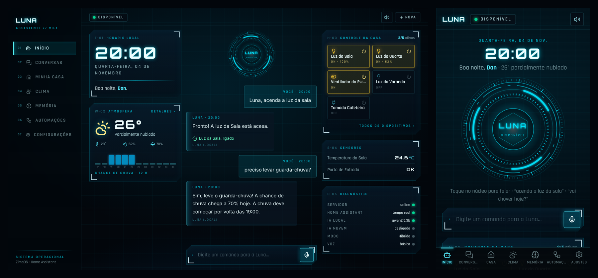

# 🌙 Luna AI

Assistente pessoal com **voz**, **IA híbrida** (Ollama local + OpenAI), **memória**, **clima por GPS** e
**controle dos dispositivos Tuya/Smart Life** via Home Assistant — como PWA instalável no iPhone,
rodando **nativamente** no seu servidor Linux/ZimaOS (sem Docker).



## O que ela faz

| Recurso | Como |
|---|---|
| Conversa por texto e voz em pt-BR | Web Speech API + SpeechSynthesis (básico) ou OpenAI Realtime via WebRTC (avançado) |
| Controla a casa | Descobre entidades **reais** do Home Assistant; liga/desliga, brilho, estados em tempo real (WebSocket) |
| Entende comandos sem LLM | NLU local para “acenda a luz da sala”, “apague todas as luzes”, “a luz do quarto está acesa?”, “que horas são?”, “vai chover hoje?” |
| IA híbrida | Roteador escolhe Ollama ou OpenAI conforme o modo (`local` / `cloud` / `hybrid`) com fallback |
| Desambiguação | “Encontrei mais de um dispositivo: Luz do Quarto Casal e Luz do Quarto Hóspedes. Qual deles?” |
| Clima | Open-Meteo (atual, 24 h, 7 dias, chuva, guarda-chuva) com cache; GPS do aparelho ou casa |
| Memória | “Lembre que…” / “esqueça que…”; painel para ver e apagar; nunca inventa lembranças |
| Automações | Rascunho → revisão → **criada de verdade no Home Assistant** (horário, pôr/nascer do sol, sair/chegar) |
| Segurança | Login, sessões HttpOnly, CSRF, rate limit, autorização por dispositivo e por papel, logs de ações |

## Conversa 100% gratuita e local

Sem gastar tokens da OpenAI: instale o Ollama no servidor e use o modo local.

```bash
sudo bash scripts/ollama-setup.sh            # instala em /DATA, serviço systemd, baixa qwen2.5:3b
sudo bash scripts/ollama-setup.sh --model qwen2.5:1.5b   # alternativa mais rápida em CPUs antigas
```

No app: **Ajustes › Inteligência artificial: Local** e **Modo de voz: Básico**. O reconhecimento de fala e a voz
ficam no aparelho (Chrome/Safari) e as respostas vêm do Ollama no seu servidor. Comandos da casa, clima e hora
continuam instantâneos (não passam pelo LLM).

## Início rápido (servidor)

```bash
git clone -b feat/luna-ai https://github.com/dbn92/jallu.git /DATA/AppData/luna-src
cd /DATA/AppData/luna-src/luna-ai
bash scripts/diagnose.sh          # FASE 1: inspeciona o ambiente, não altera nada
sudo bash scripts/install.sh      # Node local, .env, build, banco, usuário 'luna', serviço systemd
nano .env                         # HA_URL, HA_TOKEN, OLLAMA_MODEL, OPENAI_API_KEY, LUNA_PUBLIC_URL
sudo bash scripts/stop.sh && sudo bash scripts/start.sh
```

Depois publique pelo seu Cloudflare Tunnel existente ([docs/CLOUDFLARE.md](docs/CLOUDFLARE.md)), abra o domínio
no Safari, crie o administrador com o `LUNA_SETUP_CODE` e toque em **Compartilhar › Adicionar à Tela de Início**.

📘 Guia completo: [docs/INSTALL.md](docs/INSTALL.md) · Arquitetura: [docs/ARCHITECTURE.md](docs/ARCHITECTURE.md) · Segurança: [docs/SECURITY.md](docs/SECURITY.md)

## Scripts

| Script | Função |
|---|---|
| `scripts/diagnose.sh` | Diagnóstico somente leitura (SO, arquitetura, CPU/AVX, RAM, disco, Node, portas, HA, Ollama, Cloudflare) |
| `scripts/install.sh` | Instalação idempotente; nunca sobrescreve `.env` existente |
| `scripts/build.sh` | `npm ci` + build da API e do PWA |
| `scripts/start.sh` / `stop.sh` | Inicia/para via systemd, PM2 ou processo simples |
| `scripts/update.sh` | Backup do banco + `git pull` + build + migração + reinício + health-check |
| `scripts/health-check.sh` | Verifica `/api/health` local (e `--public` pelo domínio) |

## Desenvolvimento

```bash
npm install
cp .env.example .env              # ajuste HA_URL/HA_TOKEN etc.
node apps/api/scripts/migrate.mjs
npm run dev:api                   # API em :8787
npm run dev:web                   # PWA em :5173 (proxy para a API)
npm test                          # testes da API (Vitest + mocks de HA/Ollama/OpenAI/Open-Meteo) e do PWA
npm run typecheck
```

### Estrutura

```
luna-ai/
├─ apps/
│  ├─ api/                 Fastify + Prisma (SQLite)
│  │  ├─ prisma/           schema e migrações
│  │  ├─ src/
│  │  │  ├─ modules/       ai · voice · devices · weather · memory · auth · automations · settings
│  │  │  ├─ integrations/  home-assistant (REST + WS) · ollama · openai (chat, realtime, transcrição)
│  │  │  ├─ routes/        health · websocket
│  │  │  ├─ middleware/    autenticação, CSRF, papéis
│  │  │  ├─ config/        validação do .env
│  │  │  └─ server.ts
│  │  └─ tests/            testes automatizados + mocks
│  └─ web/                 React + Vite + Tailwind + PWA
│     └─ src/              components · pages · hooks · services · stores · styles
├─ packages/shared/        tipos e schemas Zod compartilhados
├─ infra/                  systemd · PM2 · Cloudflare · Ollama (exemplo)
├─ scripts/                diagnose · install · build · start · stop · update · health-check
├─ docs/                   instalação, Cloudflare, arquitetura, segurança
├─ data/                   banco local em desenvolvimento (ignorado pelo git)
└─ .env.example
```

## Limitações honestas

- **“Ei, Luna”**: no **Android/computador (Chrome)** a palavra de ativação é detectada de graça pelo navegador e a
  conversa em tempo real só abre quando chamada — ideal para um aparelho dedicado ([docs/ANDROID.md](docs/ANDROID.md)).
  No **iPhone** funciona apenas durante uma sessão de voz em tempo real aberta (o iOS não permite escuta contínua em apps web).
  Em todos os casos, só com o app aberto e em primeiro plano.
- No **PWA instalado no iPhone**, o reconhecimento de fala do Safari pode ficar indisponível
  (`service-not-allowed`). Alternativas já implementadas: **Transcrição na nuvem** (grava e transcreve na OpenAI) ou **Voz em tempo real**.
- Voz em tempo real, transcrição na nuvem e o modo `cloud` exigem `OPENAI_API_KEY` (serviço pago).
  Todo o resto funciona sem custos: comandos da casa, clima, memória e IA local.
- Modelos pequenos no Ollama (CPU do Mac mini 2012) são mais lentos e menos precisos com ferramentas;
  por isso os comandos frequentes são resolvidos pela NLU local, sem LLM.
- Criar automações exige token de **administrador** no HA e `automation: !include automations.yaml` (padrão do HA).
- “Todas as luzes” em automações é resolvido no momento da criação (luzes autorizadas naquele instante).
